# Face glare in Isaac Sim: evidence for slides 1 and 4

A minimal Isaac Sim experiment: one scanned head with a PBR skin material, controllable lighting, and a look-at RGB-D camera with 4 discrete moves. **No model was trained.** This is not a GaussianAvatars reproduction, and no baseline numbers are claimed beyond what is measured below.

All numbers come from `outputs/run_record.json` of the final run (**run 3, Slurm job 20431930**, 2026-11-07). They are tabulated in `outputs/summary_tables.md`, which `scripts/summarize.py` generates; nothing was typed in by hand.

## Renders at a glance

All images below are Isaac Sim 5.1 RTX renders from run 3 (job 20431930). The contact sheet and the overview add text labels drawn afterwards.

**Slide 1: the four views** (row 2 shows glare pixels in magenta)

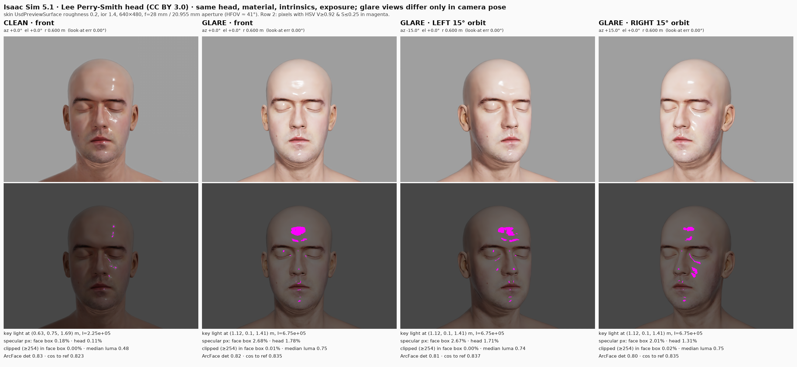

| clean_front | glare_front | glare_left | glare_right |
|---|---|---|---|
| 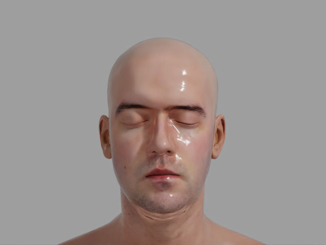 | 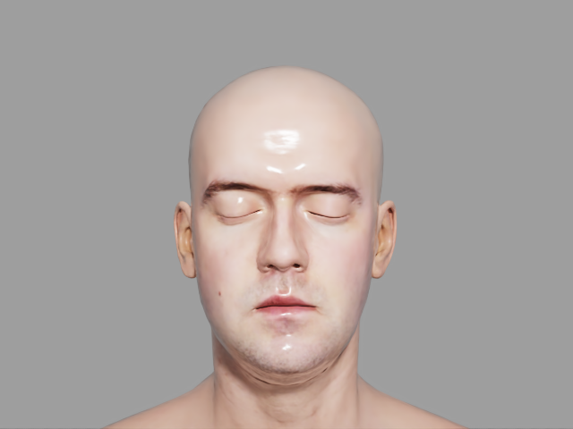 | 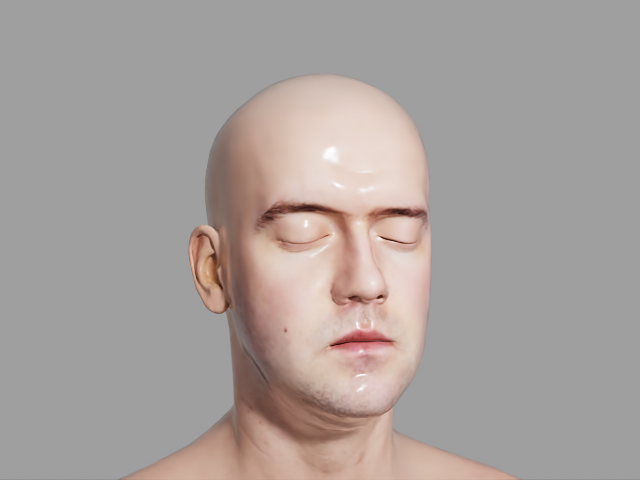 | 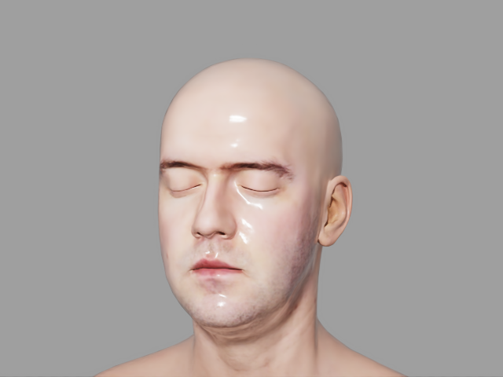 |

**Slide 4: scene overview** (proxy markers are added only for this render)

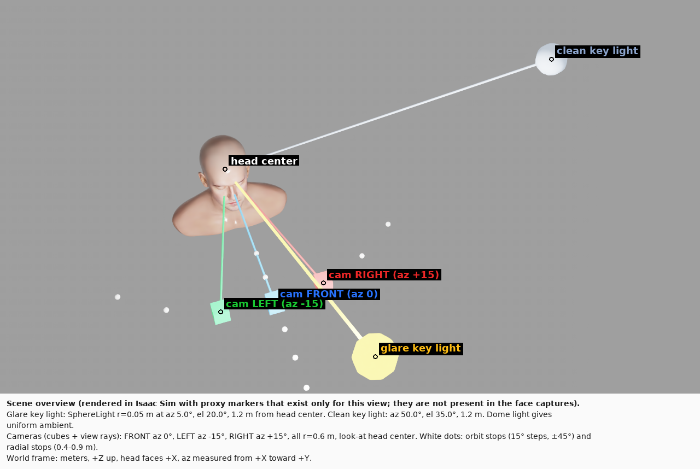

**Slide 4: 4-way actions with RGB and depth after each move**

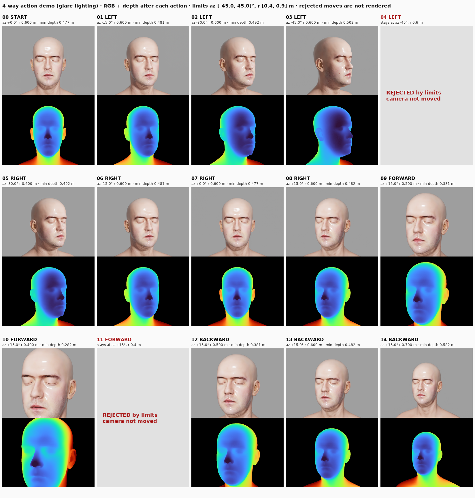

**RGB-D pair (glare_front)**

| RGB | depth (visualization of the raw `.npy`) |
|---|---|
|  | 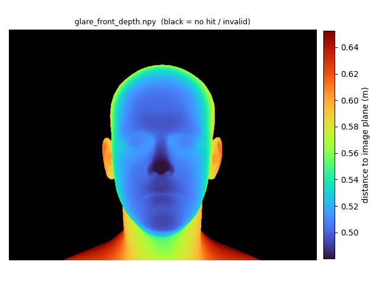 |

**Backup: roughness diagnostic and sweep**

| glare lighting, roughness 0.7 | roughness × intensity sweep |
|---|---|
| 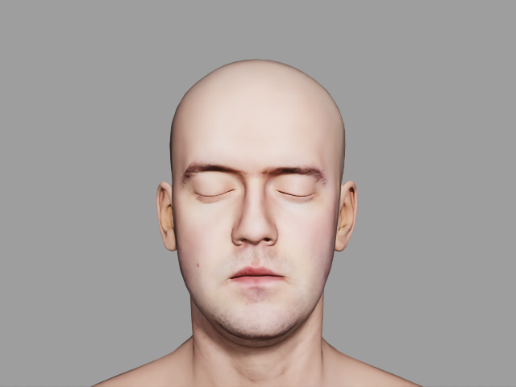 | 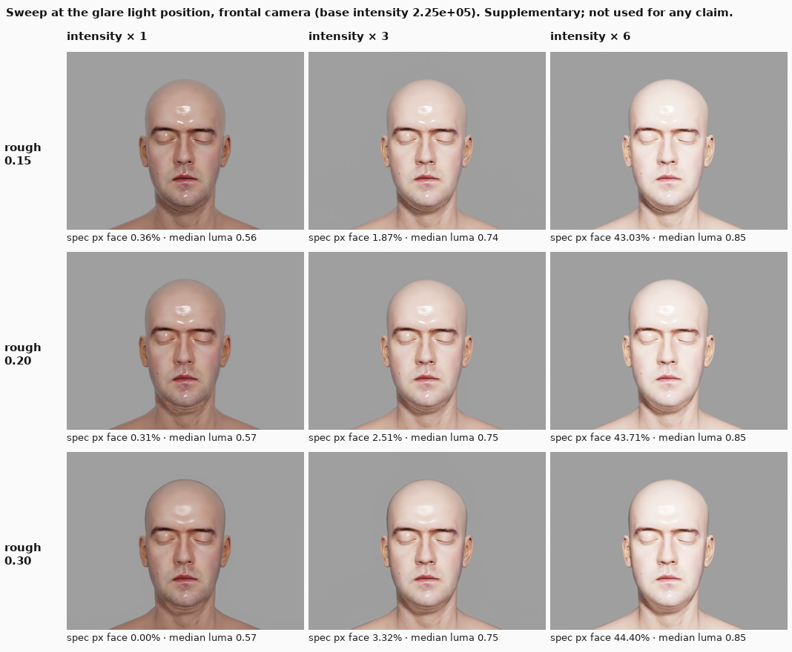 |

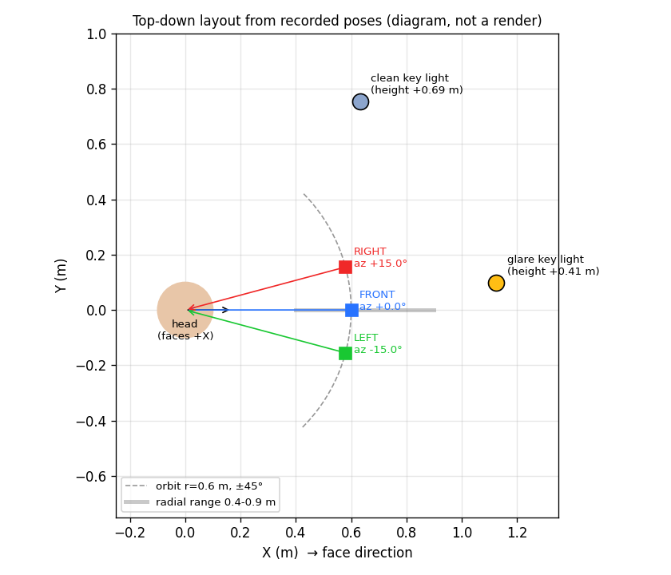

## 1. Environment

| Item | Value |
|---|---|
| Cluster | TAMU HPRC **Grace** (submitted from login4) |
| GPU | **Quadro RTX 6000** 24 GB (node r007), driver 580.126.20. RT cores, so RTX rendering works. Grace's A100 nodes have no RT cores and were not used. |
| Isaac Sim | **5.1.0** (`5.1.0-rc.19+release.26219.9c81211b.gl`), the existing Singularity image `689/hprc/isaac-sim_5.1.0_avs.sif`. It was reused, not reinstalled. It also bundles InsightFace 0.7.3 and onnxruntime-gpu. |
| Container runtime | singularity-ce 4.3.7, `--nv` plus extra RTX/OptiX/Vulkan driver libraries (binding logic copied from `689/hprc/gpu_main.sh`) |
| Rendering mode | **Headless only.** The login node has no GPU and no display. All rendering is in batch jobs with `SimulationApp({"headless": True})`. Interactive GUI rendering was not attempted (it would need a VNC/OnDemand GPU session). |
| Renderer | `/rtx/rendermode = RaytracedLighting` (RTX real-time) |
| Run time | about 25–55 s startup (warm shader cache), about 1 s per capture, about 2.5 min per full run |
| Budget | The project account has **19.97 SU** left after this work. Four short GPU jobs were run: a probe and runs 1–3. |

**Reused from earlier work:** the container, converted head USDs (`689/assets_usd`), the InsightFace `buffalo_l` models (`689/hprc/insightface`), the look-at math pattern from `active-viewpoint-selection/avs/envs/isaac_env.py`, and the glare-pixel rule (HSV V ≥ 0.92 and S ≤ 0.25) from `avs/perception.py`. Nothing in those directories was modified.

## 2. Asset

- **Head:** `689/assets_usd/lee_perry_smith/lee_perry_smith.usd`
- **Source:** "Infinite, 3D Head Scan" by Lee Perry-Smith (Infinite-Realities), based on a work at www.triplegangers.com. It is the same file distributed with the three.js examples.
- **License:** **CC BY 3.0** (`689/assets_raw/leeperrysmith/LeePerrySmith_License.txt`). Attribution is required, and redistribution is allowed. This head was chosen over the FaceVerse and Digital Emily heads because those licenses forbid redistribution, and slides are redistribution.
- **Converted asset:** made by `689/assets_tools/convert_heads.py`. It is in meters, Z-up, face toward +X, origin at the head center, with a single mesh (17,684 triangles) bound to `/Head/Looks/Skin`.
- **Material:** UsdPreviewSurface with a diffuse texture and a normal map.
- **Not used:** the scan ships a specular map (`Map-SPEC.jpg`), but the converted material does not use it. Specularity is uniform and set by the parameters in §3. No white patches or painted textures were added. All highlights come from the material's specular response to the light.
- **Glasses:** not added.

## 3. Scene, material, lighting, camera

The exported scene is `scene/face_glare_scene.usda`. It references the head USD by absolute path and holds the material overrides, lights, and cameras. The overview proxy markers are in the file but set to invisible.

| | Setting |
|---|---|
| Head | fixed at world (0, 0, 1.0) m; this point is also the orbit center and look-at target |
| Skin material | UsdPreviewSurface on the asset's own shader: **roughness 0.20**, metallic 0.0, **ior 1.4** (normal-incidence reflectance F0 ≈ 0.028, a typical skin value). Identical in all four comparison images. |
| Ambient | DomeLight, intensity 260, white, no texture (uniform gray environment and background) |
| Key light | **SphereLight**, radius 0.05 m, adjustable position and intensity |
| Clean key light | az 50°, el 35°, 1.2 m from head center → (0.632, 0.753, 1.688) m; I = 2.2505e5 |
| Glare key light | az 5°, el 20°, 1.2 m → (1.123, 0.098, 1.410) m; I = 6.7516e5 (3× clean). Close to the camera axis, like a ring light or lamp beside the camera. |
| How I was set | In run 1, the clean intensity was calibrated by log-bisection so the clean frontal face median luma was about 0.50. The result (2.25052e5) is pinned in `configs/glare_scene_pinned.json` and was used in run 3. The 3× glare gain was picked from the sweep (`outputs/sweep_roughness_intensity.png`): at 6× the whole face saturates, which is overexposure rather than glare. |
| Camera | Isaac `Camera` (`isaacsim.sensors.camera`) at **640 × 480**, focal length 28 mm, horizontal aperture 20.955 mm (HFOV ≈ 41°), clip 0.01–100 m. Intrinsics read back: fx = fy = 855.17, cx = 320, cy = 240. |
| Exposure | Fixed. Auto-exposure is off (`/rtx/post/histogram/enabled=false`). Tonemapper op 6, film ISO 100, shutter 50, f/5.0, all unchanged for every capture. |
| Settling | After every pose or lighting change, 120 frames are rendered before capture. Then 4 more frames are rendered and the change between them is recorded (mean absolute difference 0.07–0.57 on the 0–255 scale). See §7 for why 120. |

### Coordinate convention

- World frame: meters, **+Z up**, the head faces **+X**.
- Camera position = c + r·[cos(el)·cos(az), cos(el)·sin(az), sin(el)], with c = (0, 0, 1). So az = 0 is straight in front of the face, and positive az moves toward +Y.
- The orientation is always recomputed to look at c.
- Quaternions are in Isaac's "world" camera axes: +X forward, +Z up.
- **LEFT = az −15°**: the camera moves to its *own* left. At az = 0 that is −Y, which is the subject's right-hand side. **RIGHT = az +15°**.

### Recorded camera poses (read back from the stage)

| image | position (m) | quat w, x, y, z | az / el / r | look-at error |
|---|---|---|---|---|
| clean_front | (0.6, 0.0, 1.0) | (0, 0, 0, 1) | 0° / 0° / 0.600 m | 0.000° |
| glare_front | (0.6, 0.0, 1.0) | (0, 0, 0, 1) | 0° / 0° / 0.600 m | 0.000° |
| glare_left | (0.5796, −0.1553, 1.0) | (0.1305, 0, 0, 0.9914) | −15° / 0° / 0.600 m | 0.000° |
| glare_right | (0.5796, +0.1553, 1.0) | (−0.1305, 0, 0, 0.9914) | +15° / 0° / 0.600 m | 0.000° |

The left and right poses are orbits around the head: the camera position changes and the distance to the head stays 0.600 m. They are not in-place rotations.

The 15° step is an **initial design choice**. It has not been validated as an optimum.

## 4. Implemented actions (all four done)

`glare/rig.py` contains `OrbitRig` and does not import Isaac:

- **LEFT / RIGHT:** az ∓ 15° at a fixed radius.
- **FORWARD / BACKWARD:** r ∓ 0.1 m.
- **Limits:** az ∈ [−45°, 45°] and r ∈ [0.4, 0.9] m. A move outside the limits is **rejected (masked), not clipped**: the camera does not move and nothing is rendered.
- **After every move:** look-at is recomputed, the frame settles (120 frames), then RGB and depth are read from the same frame.

The demo ran 14 actions from the front pose. Full table: `outputs/summary_tables.md`. Figure: `outputs/contact_sheet_actions_rgbd.png`.

- **Rejections:** step 4 (LEFT at az −45°) and step 11 (FORWARD at r = 0.4 m) were correctly rejected.
- **Look-at error:** 0.000° at every accepted step.
- **Depth tracks radius:** nearest valid depth was 0.477 m at r = 0.6. Along the az +15° line it was 0.482 → 0.381 → 0.282 m for r = 0.6 → 0.5 → 0.4, and 0.381 → 0.482 → 0.582 m going BACKWARD to r = 0.7. That is 0.100 m per step, matching the 0.1 m command.
- **Pose repeatability:** returning to a pose gives the same depth (az −15°: 0.481 both times; az 0°: 0.477 both times).

## 5. RGB-D verification

Files: `outputs/depth/<view>_depth.npy` (raw), `outputs/depth/<view>_depth_vis.png` (visualization), and the same for each action step in `outputs/actions/`. Raw arrays are never changed by the visualization code.

- **Depth definition:** Isaac `distance_to_image_plane` annotator, read with `Camera.get_depth()`. It is the Z distance along the optical axis, not the Euclidean ray length.
- **Units:** meters (stage units = 1 m).
- **Format:** shape **(480, 640)**, float32, the same height and width as the RGB PNG (480 × 640 × 3 uint8).
- **Invalid pixels:** background pixels with no surface hit are **+inf** (glare_front: 222,869 inf, 0 NaN, 0 ≤ 0, 84,331 valid). The rule is: valid = finite and > 0 and < 100 m. The raw `.npy` keeps the inf values. The visualization paints invalid pixels black and colors the 0.5–99.5 percentile range of valid depth with a labeled colorbar.
- **Geometry check:** the nearest valid point in glare_front is 0.4771 m. Camera distance 0.600 m minus the nose-tip offset in the asset's bounding box (x_max = 0.123 m) gives 0.477 m.
- **Synchronization:** RGB and depth come from the same render product after the same step. The foreground from depth (valid pixels) and from RGB (pixels that differ from the background gray by more than 6) agree at **IoU 0.994–0.996** in every capture.

## 6. Results: the controlled comparison (run 3)

Between clean_front and glare_front, only the key light's position and intensity change. Among glare_front, glare_left, and glare_right, only the camera pose changes: same head, material, lights, intrinsics, and exposure.

| image | key light | specular px in face box | specular px on head | clipped (≥254) in face box | face median luma |
|---|---|---|---|---|---|
| `clean_front.png` | clean | 0.18% | 0.11% | 0.00% | 0.481 |
| `glare_front.png` | glare | **2.68%** | 1.78% | 0.01% | 0.749 |
| `glare_left.png` (az −15°) | glare | **2.67%** | 1.71% | 0.00% | 0.740 |
| `glare_right.png` (az +15°) | glare | **2.01%** | 1.31% | 0.02% | 0.748 |
| `diag_glare_front_rough0.70.png` (diagnostic only) | glare, roughness 0.7 | 1.06% | 0.73% | 0.00% | 0.759 |

"Specular px" means pixels with HSV value ≥ 0.92 and saturation ≤ 0.25 (bright and nearly white). The face box comes from the InsightFace detector on each image. "Head" means all pixels with valid depth.

### Observations

- **Glare appears.** Moving the light near the camera axis creates a bright forehead hotspot plus highlights on the nose bridge, the upper lip and chin, and the eyelids. In the face box, specular pixels go from 0.18% to 2.68%.
  - The face also gets brighter overall (median luma 0.48 → 0.75), so this is glare *plus* more light, not glare alone.
  - Almost nothing is hard-clipped (≤ 0.02% of face-box pixels at ≥ 254). The hotspot is very bright but not saturated.
- **The highlights come from the material.** Under identical glare lighting, raising roughness from 0.2 to 0.7 cuts specular pixels from 2.68% to 1.06% while brightness stays the same (luma 0.759). Some bright, nearly white pixels remain at roughness 0.7. The rule is a brightness heuristic, not a true specular mask.
- **The clean image is not glare-free.** The oblique clean light still leaves a thin specular streak on the right side of the forehead and on the cheek (0.18%).
- **LEFT (az −15°) did not reduce the glare.** It measured 2.67% versus 2.68% frontal, and the forehead hotspot is still there.
- **RIGHT (az +15°) lowered the measured fraction to 2.01%, but the glare moved rather than went away.** The forehead hotspot shrinks, and a new streak appears along the side of the nose and the cheek on the image-right side.
  - This difference is about the same size as the run-to-run spread (§7), so **neither move clearly improves visibility in this single configuration**.
  - Larger orbits did lower the fraction in the action demo (az ±30–45°: 1.1–1.3%), but those views turn the face away and are not part of this comparison.

### ArcFace (optional, done)

- **Model:** pretrained InsightFace `buffalo_l`, already in the container. Detector `det_10g` and recognizer ArcFace `w600k_r50`, run on onnxruntime-gpu with the CUDA provider. Same InsightFace preprocessing for every image: detection, 5-point alignment, 112×112 crop.
- **Reference:** `arcface_reference_front.png`, a separate frontal render of the same head under the dome light only, with the key light off. It is the same synthetic identity.

| image | face detected | det score | cosine to reference |
|---|---|---|---|
| clean_front | yes | 0.833 | 0.823 |
| glare_front | yes | 0.820 | 0.835 |
| glare_left | yes | 0.808 | 0.837 |
| glare_right | yes | 0.800 | 0.835 |

- **Detection succeeded in all four images.**
- **Detector score:** it dips slightly under glare (0.833 → 0.800–0.820).
- **Cosine similarity:** the differences are 0.01–0.02, which is **within the run-to-run variation** I measured (clean_front's cosine moved by 0.037 between runs 2 and 3). **These numbers do not show a glare effect on recognition in this setup.**
- **Limits of the test:** it covers one identity, one image per condition, and no impostors. It is not a recognition success rate.

## 7. Settling and repeatability (found during the work)

- **Runs 1 and 2 under-measured glare.** They waited 30 frames after each change. In run 2, glare_front measured 2.27% specular pixels, while the same pose and lighting measured 2.94–3.02% later in the action demo.
- **The probe in run 3 traced the cause.** It switches clean → glare and samples a fixed center box. The specular fraction was: 1 frame 0.20%, 5 frames 1.24%, 10 frames 2.35%, 30 frames 2.77%, 60 frames 3.00%, 120 frames 3.29%, 240 frames 3.58%, 480 frames 3.42%. So RTX real-time takes **about 240 frames** to converge after a light moves. The probe data is in `run_record.json → settle_probe`.
- **Run 3 used 120 frames**, so its absolute glare fractions may still be **about 5–10% low** compared with a fully converged render. Comparisons within run 3 use the same 120-frame wait.
- **Run-to-run spread** (same configuration, runs 2 and 3, partly from the different settle counts): mean absolute RGB difference 0.9–1.2 on the 0–255 scale; specular fraction differences up to 0.4 percentage points; ArcFace cosine differences up to 0.037.
- **Recommended next step (not run):** set `render.settle_frames` to 240 or more, or measure until the image stops changing.

Run folders:
- `outputs/`: **final, run 3** (job 20431930, pinned intensity, 120-frame settle)
- `outputs_run1_calibrated/`: run 1 (job 20431812). Contains the intensity calibration history (`key_calibration`). Used a 30-frame settle and an earlier, cluttered overview viewpoint.
- `outputs_run2_pinned_settle30/`: run 2 (job 20431907). Pinned intensity, 30-frame settle; this run exposed the settling issue.

## 8. Deliverables

| Slide | File |
|---|---|
| 1 | `outputs/clean_front.png`, `glare_front.png`, `glare_left.png`, `glare_right.png` |
| 1 | `outputs/contact_sheet_face_views.png`: 4 views, labeled with conditions, poses, light, metrics, and ArcFace |
| 1 (backup) | `outputs/diag_glare_front_rough0.70.png`, `outputs/sweep_roughness_intensity.png` |
| 4 | `outputs/scene_overview.png`: Isaac render with proxy markers, labeled. Markers are added only for this render and are never present in face captures. |
| 4 | `outputs/scene_topdown_diagram.png`: diagram drawn from recorded poses, **not a render** |
| 4 | `outputs/contact_sheet_actions_rgbd.png`: RGB and depth after each action, including the 2 rejected moves |
| 4 | `outputs/depth/glare_front_depth.npy` + `glare_front_depth_vis.png` + `glare_front.png`: the main synchronized RGB-D pair |
| all | `outputs/run_record.json`: every setting, pose, statistic, and ArcFace result; `outputs/summary_tables.md`; `outputs/capture.log` |

## 9. Code: what is executable and what is planned

Everything listed here was executed in this work. There is no pseudocode in the project.

- `glare/rig.py`: orbit rig, actions, limits, look-at quaternion, pose check (pure numpy)
- `scripts/run_capture.py`: Isaac Sim 5.1 script that builds the scene, calibrates or pins intensity, runs the sweep, the settling probe, the captures, the diagnostic, the action demo, the overview, and ArcFace, then exports the USD
- `glare/figures.py`: depth visualizations and contact sheets (no Isaac needed)
- `scripts/summarize.py`: Markdown tables from the record
- `configs/glare_scene.json`: calibrates intensity at run time; `configs/glare_scene_pinned.json`: the final run's settings
- `hprc/run_glare.sbatch`: Slurm job on a Grace RTX 6000 node

**Planned, not done:**
- Spatially varying specular from the scan's `Map-SPEC.jpg`
- Subsurface scattering
- Glasses
- Fully converged settling (≥ 240 frames)
- A light sweep to find where viewpoint changes do help
- Multiple identities or impostors for ArcFace
- Moving the camera with a robot arm (the camera is teleported)

## 10. Reproduce

Run these on a Grace login node.

```bash
cd /scratch/user/qingxiao/689/glare_slides

# final run (pinned intensity, same settings as outputs/); about 3 min on one RTX 6000, about 1.5 SU
CFG=$PWD/configs/glare_scene_pinned.json OUT=$PWD/outputs_repro sbatch --export=ALL hprc/run_glare.sbatch

# alternative: re-calibrate the key intensity from scratch
CFG=$PWD/configs/glare_scene.json OUT=$PWD/outputs_recal sbatch --export=ALL hprc/run_glare.sbatch

# figures and tables only (no GPU; runs the container's python on the login node)
SIF=/scratch/user/qingxiao/689/hprc/isaac-sim_5.1.0_avs.sif
singularity exec $SIF /isaac-sim/python.sh glare/figures.py --out outputs_repro
singularity exec $SIF /isaac-sim/python.sh scripts/summarize.py outputs_repro outputs > outputs_repro/summary_tables.md
```

`run_glare.sbatch` requests `--gres=gpu:rtx:1`. A T4 (`gpu:t4:1`) also has RT cores and should work, but it was not tested on Grace. A100s cannot run RTX rendering.

Every run overwrites `scene/face_glare_scene.usda`.

Attribution for slides: *Head scan: "Infinite, 3D Head Scan" by Lee Perry-Smith, CC BY 3.0.*
